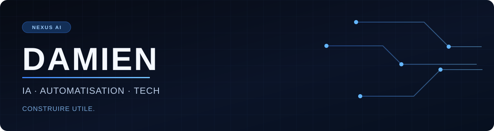

  

 

### Salut, moi c'est Damien.

Je m'intéresse à l'IA, à l'automatisation et aux outils qui rendent une tâche plus simple, plus fiable ou plus claire. J'aime partir d'un besoin concret, construire une solution sobre, puis expliquer comment elle fonctionne.

### Ce que je construis

| Axe | Ce que j'explore |
| --- | --- |
| **NEXUS AI** | Un univers de projets en construction autour d'une IA utile et maîtrisée. |
| **Automatisation** | Des flux qui relient des outils, réduisent les gestes répétitifs et gardent une place pour la vérification humaine. |
| **Tech & données** | Des applications et des expériences documentées, avec une attention portée à la lisibilité et à la confidentialité. |

### Ma façon de travailler

`Besoin réel` → `Prototype` → `Test` → `Documentation` → `Amélioration`

Je publie ici les projets que je peux présenter clairement : leur objectif, leur fonctionnement, leurs limites et ce que j'en ai appris.

---

Construire utile. Rester curieux. Faire simple.
