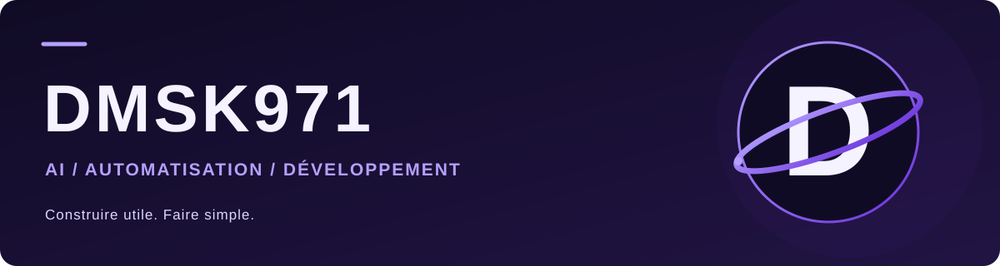

  

### Salut, moi c’est Damien 👋

Je suis en alternance chez Orange. À côté, je développe des sites web, des automatisations et des assistants IA. Ce qui me plaît, c’est de partir d’un problème concret, de construire un outil qui fait gagner du temps et de le tester jusqu’à ce qu’il soit vraiment utile.

### Ce que je construis

| Domaine | Ce que j'explore |
| --- | --- |
| **IA & agents** | Assistants personnels, modèles locaux et orchestration d'agents. |
| **Automatisation** | Workflows n8n, intégrations entre outils et tâches répétitives simplifiées. |
| **Développement** | Applications web, bots, tableaux de bord et interfaces utiles. |
| **Fiabilité** | Tests, documentation, confidentialité et contrôle humain. |

### Projets en cours

- **NEXUS AI** — un environnement d'expérimentation autour d'agents IA et d'automatisations.
- **Zozo** — un assistant Discord personnel et des intégrations pour mon environnement numérique.
- **DMSK Studio** — des expériences de développement web et d'outils orientés usages concrets.

*Certains projets sont privés ou encore en développement. Je partage publiquement ce qui peut être présenté et documenté proprement.*

### Outils & technologies

`JavaScript` · `Node.js` · `React` · `Python` · `n8n` · `Docker` · `PostgreSQL` · `Ollama` · `GitHub Actions`

### Ma méthode

`Besoin` → `Prototype` → `Test` → `Documentation` → `Amélioration`

---

Construire utile. Rester curieux. Faire simple.
